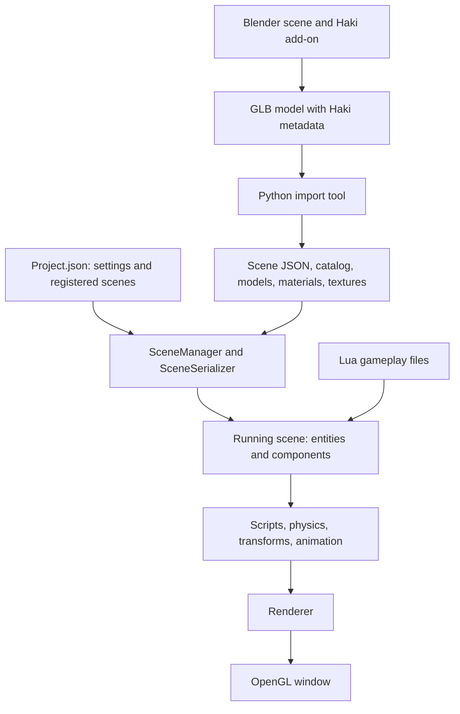

# 1. The big picture

[Guide index](README.md) · Next: [Startup and the frame loop](02-startup-and-frame-loop.md)

Haki takes a scene you author in Blender, converts it into files the engine understands, and runs it with C++, Lua, OpenGL, and Jolt.

Think of a scene as the contents of one playable place: its floor, walls, player, camera, lights, and rules. The engine provides the systems that make those things work. Your game supplies the particular objects, artwork, and rules.

## The full journey

In words: Blender authors the scene; Python prepares its runtime files; C++ loads those files into a live scene; simulation changes that scene; the renderer draws its current state.

There are two different kinds of import here. **The Python importer prepares files on disk. The runtime loaders read those prepared assets into memory.** Neither step runs Blender inside the engine.

## The main boundaries

| Part | Its responsibility | Where it lives |
| --- | --- | --- |
| Engine | General systems such as rendering, physics, assets, and scripting | `src/Haki/` |
| Game | Arenas, characters, materials, and game rules | `Assets/Game/` |
| Engine defaults | Reusable shaders, primitive geometry, fonts, default environment | `Assets/Engine/` |
| Authoring | Object placement, colliders, script assignment, and export settings | Blender and `tools/blender/haki_editor/` |
| Import tools | Validate exports and create scene packages | `tools/import_gltf_pack.py` |
| Tests | Check individual systems and pipeline behavior | `src/Tests/` and `tools/tests/` |

For example, deciding that a punch deals 20 damage belongs in game logic. Providing a sphere query that finds nearby physics objects belongs in the engine. This keeps the engine reusable for your next game.

## The runtime has a small chain of ownership

`Game` owns the window, renderer, and scene manager. `SceneManager` owns one active scene. That scene owns its entity storage, physics world, and Lua script system. Loaded assets live in a shared asset manager, outside a particular scene.

**Ownership** means responsibility for creating, keeping, and destroying a thing. If a scene owns its physics world, leaving that scene should remove that world and its bodies. A model resource can remain loaded because the asset manager owns it separately.

The engine mostly uses C++ objects to manage these lifetimes. A `std::unique_ptr<Scene>` means there is one owner of that scene. A `std::shared_ptr<AssetCatalog>` means several systems refer to the same catalog and keep it alive together. These are memory ownership tools, not asset file formats.

## How an object gets behavior

An object in the scene is an **entity**. An entity is an identifier with attached pieces of data called **components**.

A floor can have a transform, a mesh renderer, a rigid body, and a collider. A camera can have only a transform and camera component. A player controller can have a transform, character controller, and script, while its animated visual is a separate child entity.

A **system** reads matching components and performs work. Physics looks for physics components. Animation looks for skinned meshes and animators. Rendering looks for visible geometry and materials.

This pattern is called an entity-component system, or ECS. Here it is built using EnTT. The name is less important than the idea: objects are made by combining data, rather than putting every possible behavior into one huge `GameObject` class.

## What the libraries contribute

| Library | Plain explanation |
| --- | --- |
| GLFW | Creates the desktop window and connects to desktop input and displays |
| OpenGL + GLAD | OpenGL draws using the GPU; GLAD loads the functions the program calls |
| GLM | Vectors, matrices, and rotation math |
| EnTT | Stores entities and their components; lets systems find matching entities |
| Jolt | Collision detection, rigid body simulation, and character collision support |
| Lua + sol2 | Lua runs gameplay scripts; sol2 connects Lua calls to C++ |
| cgltf | Reads glTF model data at runtime |
| nlohmann/json | Reads and writes JSON in C++ |
| gainput | Represents input devices, states, and action mappings |
| Dear ImGui | Development menus, inspectors, and debugging panels |
| stb | Image/font support used by the engine |

Haki still decides how these libraries cooperate. Jolt does not know what a Haki scene file is. OpenGL does not know which Blender object is the player. Those connections are engine code.

## Current strengths and current limits

The present structure is well suited to building and testing a small arena: authored maps, a controlled player, animation, Lua behaviors, physics queries, and adjustable graphics.

Scene changes currently load synchronously: the main thread does the loading work. Registering many scenes does not mean they are all loaded. There is no background world streaming service in this code.

Jolt uses worker threads for parts of physics. This does not make EnTT, Lua, the asset manager, or OpenGL safe to access from arbitrary worker threads. A general engine job system and network simulation architecture would require additional design.

## Try this

Open the current [project manifest](../../Assets/Game/Project.json). Find its `entry` value, then follow the matching scene's `source` path. Open that scene JSON and find one camera and one character controller. You have just followed the engine's first important chain: **project → scene → components**.

## Source reading route

1. [main.cpp](../../src/main.cpp): the program entry point.
2. [Game.h](../../src/Haki/Core/Game.h): the top-level owned systems.
3. [Scene.h](../../src/Haki/Scene/Scene.h): what belongs to one scene.
4. [Components.h](../../src/Haki/Scene/Components.h): the data systems operate on.
