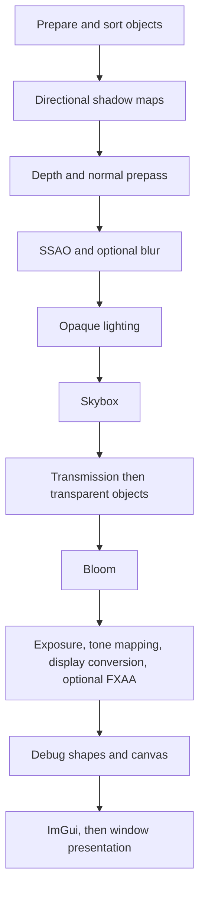

# 6. The renderer

[Guide index](README.md) · Previous: [Assets and Blender](05-assets-and-blender.md) · Next: [Physics](07-physics.md)

The renderer turns the current scene into an image. It does not decide how the player moves or which attacks deal damage. It receives a camera, lights, environment, and objects to draw.

Haki currently uses **OpenGL 3.3** and a **forward renderer**. Forward means each visible surface is shaded using the lights and material while that surface is drawn. The extra shadow, depth, and post-processing passes do not make this a deferred renderer.

## Begin with one triangle

A mesh contains vertices and usually indices. A **vertex** is a point with data such as position, normal, UV coordinates, and color. An **index** says which vertex to reuse when forming a triangle.

A **normal** describes which way a surface faces. A **UV** is a 2D coordinate used to look up a color or value in a texture. A tangent supplies another surface direction, useful for normal maps.

The CPU prepares buffers and asks the GPU to draw. Two small GPU programs do most of the visible work:

- The **vertex shader** positions each vertex. For animated geometry it also applies bone deformation.
- The **fragment shader** calculates a candidate pixel's color using the material, textures, lights, and other inputs.

Between them, the GPU fills the triangle's screen area. This is called **rasterization**. Values such as UVs and normals are smoothly carried across the triangle for the fragment shader to use.

```text
vertex data
  → vertex shader
  → triangles cover screen samples
  → fragment shader
  → depth/blending checks and output
```

A **depth buffer** stores how close the visible surface is at each pixel. It prevents a wall behind the player from painting over the player merely because it was submitted later.

## Coordinates along the way

For an ordinary vertex, the main transformation is:

```text
clip position = Projection × View × Model × local position
```

`Model` is the object's world matrix. `View` describes the camera. `Projection` supplies perspective or orthographic projection. The GPU then divides by the clip coordinate's W value and maps the result into the viewport.

This is why a correct mesh can disappear because of a bad camera, an incorrect world transform, or near/far clipping. The mesh file is only one part of its final position.

## What a material is

A material combines a shader, parameter values, textures, and drawing rules. A shader is the program; a material supplies that program's inputs for one appearance.

For example, two wooden props can share the same shader but use different base colors or roughness values. `MaterialState` also controls backface culling, depth testing/writing, blending, and whether the material uses the transmission pass.

The current imported shader is `GltfPBR`. **PBR** means physically based rendering: it models roughness, metalness, and light reflection in a reasonably consistent way. A stylized palette texture can still use this renderer. The desired hand-painted/toon art direction does not mean a complete toon-outline and rim-light pipeline is already implemented.

Useful material ideas:

| Input | What it changes |
| --- | --- |
| Base color | The main surface color |
| Roughness | Whether reflections look sharp or broad |
| Metalness | Whether the surface behaves like a metal |
| Normal map | Small lighting detail without changing the mesh outline |
| Emissive | Surface brightness that does not depend on incoming light |
| Alpha | Whether a surface is solid, cut out, or blended |
| Transmission | Light/background visibility through a surface |

An emissive surface does not automatically become a light that illuminates nearby objects. It can contribute to bloom, which is an image effect.

## How the scene submits work

`Scene::OnRender()` gathers the selected camera, environment, and light components. It calls `BeginFrame()`, then submits one `RenderItem` per drawn submesh.

A submesh is a range of a mesh that can be drawn separately, often because it uses a different material. One entity can therefore produce multiple draw calls.

A render item contains mesh and material handles, a world matrix, a submesh index, and optional bone matrices. It does not contain a full entity or Lua script. This keeps the renderer focused on drawing.

The scene then queues Lua canvas drawing, calls `Render()`, and calls `EndFrame()`. The renderer borrows a skinned item's joint matrices until those submissions have been processed; the owner must keep them alive during that work.

## Preparing the drawing list

The renderer resolves handles, skips unusable submissions, computes bounds, and separates opaque, transmission, and transparent objects.

**Frustum culling** means skipping geometry outside the camera's view volume. Bounds make this test cheaper than checking every triangle. Off-screen opaque objects can still enter the shadow pass because they may cast a visible shadow.

Skinned meshes currently keep bind-pose bounds, which may be too small once a character moves its limbs. The renderer avoids ordinary frustum culling for these animated submissions rather than incorrectly hiding them.

Opaque items are sorted by shader, material, and mesh to reduce changes in GPU state. Transparent items are sorted mainly from far to near because blending depends on what was drawn behind them.

Sorting is an optimization, not automatic instancing. Reusing a mesh and reducing draw calls are related but separate ideas.

## The rendering passes in order

A **pass** is one stage of drawing, often writing into a particular image rather than directly to the window.



Some stages are disabled by settings or skipped when unnecessary. In words: first prepare visibility and lighting information, draw the scene into a bright-color image, adjust that image for display, then put overlays on top.

### 1. Directional shadow maps

A shadow map records scene depth from a light's point of view. A surface asks: “Am I farther from the light than the nearest recorded surface?” If yes, something blocks the light.

The renderer uses the first directional light for its shadow direction and splits camera depth into **four cascades**. Near regions get a more useful share of texture detail than if one map covered the entire world uniformly.

`ShadowDistance` limits the covered distance. `ShadowMapResolution` controls map detail. PCF smooths shadow comparisons by sampling nearby texels; PCSS adds a more expensive estimate of softness based on blockers. Neither replaces correct mesh normals or correct light direction.

Drawing into four shadow maps costs extra geometry work. A crate visible once can be drawn again for shadows. The shadow counters help explain why total work exceeds the visible object's single draw.

### 2. Depth and normal prepass

This stage draws opaque geometry with a simpler shader to record depth and surface direction. SSAO uses those images.

When the depth prepass is enabled, its depth can also be copied to the main target so expensive lighting avoids repeatedly shading surfaces hidden behind other surfaces. The extra pass has its own cost, so measure the result instead of assuming it always helps.

Wireframe mode skips this prepass and SSAO because triangle-filled depth is a poor match for drawing only triangle edges.

### 3. SSAO

**Screen-space ambient occlusion** estimates where nearby surfaces block indirect light, using screen depth and normals. It adds contact shading around objects and corners.

It only knows what the current screen buffers contain. It is not full world-space light simulation and cannot discover all hidden geometry.

Sample count, radius, bias, power, half-resolution mode, and blur affect its cost and appearance. Too much strength can make a bright stylized arena look dirty or dark at every prop edge.

### 4. Opaque lighting and the environment

The main shader combines material values, direct lights, shadows, and indirect lighting. Current light limits per frame are 4 directional, 64 point, and 16 spot lights. Extra lights beyond these arrays are not all processed.

The environment is an HDR image representing surrounding light. The renderer prepares cube maps for the visible environment and filtered versions used for diffuse and rough reflections. This is **image-based lighting**, or IBL.

Diffuse lighting describes broad surface response. Specular lighting describes reflection. The engine also has ambient sky/ground settings. These controls help fill surfaces that are not facing a direct light.

The skybox is the visible background. It has its own toggle. Turning it off does not require turning off indirect diffuse or specular lighting.

### 5. Transmission and transparency

The transmission path copies the already drawn opaque scene/background so a transmitting surface can sample what is behind it. This is a screen-based approximation, not ray-traced refraction through arbitrary layers.

Other transparent materials are then drawn with blending. Transparent objects are harder to sort perfectly than opaque ones, particularly when surfaces overlap or intersect. Keep that limitation in mind when designing effects.

### 6. Bloom, exposure, and tone mapping

The scene is drawn into a floating-point HDR target. **HDR** allows brightness values greater than 1, so bright lights and emissive surfaces keep useful brightness information before display conversion.

Bloom filters bright parts of the image through smaller images and combines a soft glow. `BloomThreshold` selects what contributes; `BloomIntensity` sets how much glow is added.

Exposure scales brightness. An ACES-style tone-mapping curve compresses HDR values into a displayable range. The shader then applies a display gamma conversion. This is why a numeric base color is not necessarily the exact final screenshot color.

Color textures should be read with their color-space meaning intact. Base-color images and data textures such as normals do not have the same interpretation. Accidentally treating a normal map as display color changes the numbers used by lighting.

### 7. FXAA and overlays

FXAA is a final image filter that softens jagged edges using local contrast. It can reduce aliasing cheaply but may soften fine details too.

Debug lines and the canvas are drawn after scene post-processing. ImGui is rendered after the scene renderer finishes. This helps text remain readable rather than glowing and changing with scene exposure.

## What framebuffers and GPU buffers are

A **framebuffer** chooses where drawing goes. It can point to textures containing color, depth, or other values. Render-to-texture is what makes SSAO, shadows, bloom, and final image filters possible.

A **GPU buffer** stores data on the GPU: vertices, indices, camera values, light arrays, object transforms, or bone matrices. Uniform buffers group values so shaders can access them consistently. Haki keeps shared camera/light data separate from per-object data.

The wrappers in `src/Haki/GL` create, bind, move, and release these resources. They hide repeated OpenGL setup; they do not remove the need for a valid context and correct lifetime.

## Resolution and cost

Telemetry distinguishes three sizes:

| Size | Meaning |
| --- | --- |
| Window | Logical desktop dimensions |
| Game | Actual framebuffer pixels, including display scaling |
| Render | Internal scene target after render-height and render-scale choices |

With a 1920×1080 framebuffer, `renderHeight = 720`, and `renderScale = 1`, the internal target is 1280×720. A render scale of 0.5 then makes it 640×360. Presentation scales the result to the game framebuffer; canvas overlays use the output viewport.

Lowering render scale reduces pixel work but does not necessarily reduce the number of objects, physics work, or shadow draws. A CPU bottleneck may barely improve.

## Reading the counters

`SubmittedItems` is not the same as `DrawCalls`. Some submissions are culled or skipped; others produce work in multiple passes. Separate counters track shadows, depth/SSAO, bloom, transmission, canvas, and state changes.

GPU timings arrive a few frames later through timer queries. CPU time around render submission measures CPU work and waiting, not the same thing as pure GPU execution time. Use both rather than treating one number as the whole cost.

## Try this

On the same camera view, toggle SSAO, bloom, and shadows one at a time. Predict which visible change and which timing/counter should change. Then compare. This teaches more than changing several settings together.

## Source reading route

1. [RendererTypes.h](../../src/Haki/Renderer/RendererTypes.h): inputs, settings, limits, and counters.
2. [Scene.cpp](../../src/Haki/Scene/Scene.cpp): gathering and submitting render items.
3. [Renderer.cpp](../../src/Haki/Renderer/Renderer.cpp): `BeginFrame`, `ExecuteForwardPass`, `EndFrame`, then individual passes.
4. [GltfPBR.vert](../../Assets/Engine/Shaders/GltfPBR.vert) and [GltfPBR.frag](../../Assets/Engine/Shaders/GltfPBR.frag): surface shaders.
5. [GL wrappers](../../src/Haki/GL): mesh, buffer, texture, shader, and framebuffer ownership.
